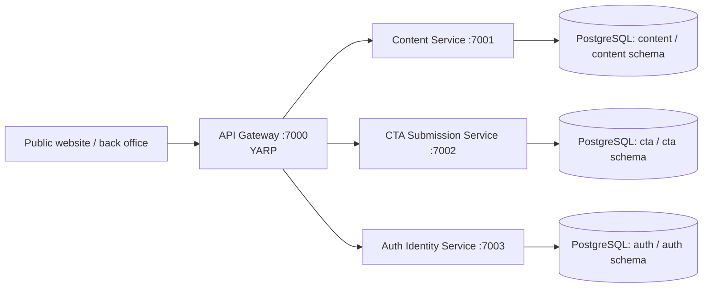

# KJWebsite.Backend

The .NET 10 backend scaffold for Kolpojontro Foundation's public site and future back office. It currently serves development APIs and is not a production deployment.

> [!WARNING]
> ## Development account and keys — read before deploying
> Passwords are hashed (ASP.NET Core Identity), access tokens are signed JWTs and content administration needs a permission claim. Still **do not expose this backend publicly** until the remaining P1 items are done (rate limiting, secrets and backups, a first deployment runbook).
>
> The development seed account `admin@site.org` / `admin123` exists **only in Development** and is disabled at startup anywhere else. Outside Development the Auth service refuses to start without `Jwt__PrivateKeyPem` (see [docs/AUTH_TOKENS.md](docs/AUTH_TOKENS.md)). Account emails (confirmation, password reset) are not delivered until the email work in #32 lands; in Development the tokens are written to the Auth log.

## Overview

Four ASP.NET Core Minimal API services sit behind a YARP gateway. The gateway is the public API entry point for the public website and future back office. The implementation roadmap and the execution order of the open issues (`[BE-NNN]` titles) are in [docs/MASTER_PLAN.md](docs/MASTER_PLAN.md).

## API preview

| Service | Scalar reference | Health check |
|---|---|---|
| API Gateway | http://localhost:7000/scalar/v1 | http://localhost:7000/health |
| Content Service | http://localhost:7001/scalar/v1 | http://localhost:7001/health |
| CTA Submission Service | http://localhost:7002/scalar/v1 | http://localhost:7002/health |
| Auth Identity Service | http://localhost:7003/scalar/v1 | http://localhost:7003/health |

## Tech stack

| Concern | Technology | Version / status |
|---|---|---|
| Runtime | .NET / C# | SDK 10.0.300; projects target `net10.0` |
| HTTP APIs | ASP.NET Core Minimal APIs | .NET 10 |
| Gateway | YARP | 2.2.0 |
| API reference | ASP.NET Core OpenAPI / Scalar | 10.0.8 / 2.14.14 |
| Data | EF Core with PostgreSQL 17 / Npgsql | Auth and CTA own separate databases and schemas |
| Contract | `openapi.v1.yaml` | generated and committed |

No build, coverage, or deployment badges are shown because CI and hosted deployment do not exist yet.

## Architecture



| Service | Port | Responsibility | Database | Exposure |
|---|---:|---|---|---|
| `ApiGateway` | 7000 | Routes content, CTA, auth, and admin-content APIs | None | Public entry point |
| `ContentService` | 7001 | Public projects/news and admin mutations | PostgreSQL (`content` database/schema) | Internal |
| `CtaSubmissionService` | 7002 | CTA and registration-form submissions | PostgreSQL (`cta` database/schema) | Internal |
| `AuthIdentityService` | 7003 | Identity, JWT login/refresh/logout, sessions, and profile | PostgreSQL (`auth` database/schema) | Internal |

## Getting started

### Prerequisites

- [.NET SDK 10.0.300](https://dotnet.microsoft.com/download) or compatible .NET 10 SDK
- The manifest-managed `dotnet-ef` tool
- PostgreSQL 17 with the `auth` and `cta` databases and connection strings, to run the Auth and CTA services (Docker is not used)

```bash
dotnet tool restore
dotnet restore KJWebsite.Backend.slnx
dotnet build KJWebsite.Backend.slnx -c Debug
```

On Windows, use `dotnet` from a terminal with the SDK on `PATH`; do not hard-code `C:\\Program Files\\dotnet\\dotnet.exe`.

### Run all services locally

Set `ConnectionStrings__AuthDb`, `ConnectionStrings__CtaDb` and `ConnectionStrings__ContentDb` to PostgreSQL connection strings (see [database and migrations](#database-and-migrations)), then open four terminals from the repository root:

```bash
dotnet run --project src/Services/ApiGateway --launch-profile http
dotnet run --project src/Services/ContentService --launch-profile http
dotnet run --project src/Services/CtaSubmissionService --launch-profile http
dotnet run --project src/Services/AuthIdentityService --launch-profile http
```

The gateway at `http://localhost:7000` expects the downstream services on their listed ports. Scalar and health URLs are in [API preview](#api-preview).

### Configuration

| Variable | Required | Default | Purpose |
|---|---|---|---|
| `ASPNETCORE_ENVIRONMENT` | No | Host default | Use `Development` locally; Scalar and runtime OpenAPI are mapped only then. |
| `ASPNETCORE_URLS` | No | `launchSettings.json` port | Overrides a listener. |
| `ConnectionStrings__AuthDb` | Yes, for Auth | None | Auth PostgreSQL connection string. |
| `ConnectionStrings__CtaDb` | Yes, for CTA | None | CTA PostgreSQL connection string. |
| `ConnectionStrings__ContentDb` | Yes, for Content | None | Content PostgreSQL connection string. An empty database is migrated and seeded with the site's current projects and news. |
| `Jwt__PrivateKeyPem` | Yes, for Auth outside Development | Dev key file | PKCS#8 RSA signing key. Never commit it. |
| `Jwt__PublicKeyPem` | Yes, for Content/CTA outside Development | Auth's dev key | The Auth service's public key, for verifying access tokens. |
| `ReverseProxy__Clusters__{content,cta,auth}__Destinations__{name}__Address` | Yes, for the gateway outside Development | `appsettings.{Environment}.json` | Gateway downstream destinations; see [docs/GATEWAY.md](docs/GATEWAY.md). |
| `Jobs__Storage`, `Outbox__MaxAttempts`, … | No | `PostgreSql`, 8 attempts | Background jobs and outbox tuning; see [docs/OUTBOX.md](docs/OUTBOX.md). |
| `Email__Postmark__ServerToken`, `Email__FromAddress`, `Email__OrgInbox` | Yes, for CTA outside Development | Development writes mail to a local folder | Transactional email; see [docs/EMAIL.md](docs/EMAIL.md). |

Secrets (signing key, connection strings, provider tokens) are read only from user-secrets, environment variables or a vault; none is committed. See [docs/SECRETS.md](docs/SECRETS.md) for the inventory and the key-rotation procedure, and [docs/SECRET_SCAN.md](docs/SECRET_SCAN.md) for the history scan (`tools/scan-secrets.sh`).

## Database and migrations

Auth, Content and CTA use Npgsql and apply their PostgreSQL EF Core migrations at startup. Each has a named schema and its own migration-history table. To create and apply a new Auth migration, set `ConnectionStrings__AuthDb` first and run:

```bash
dotnet ef migrations add <MigrationName> --project src/Services/AuthIdentityService --startup-project src/Services/AuthIdentityService
dotnet ef database update --project src/Services/AuthIdentityService --startup-project src/Services/AuthIdentityService
```

Use the equivalent CTA paths and `ConnectionStrings__CtaDb` for CTA migrations. The [SQLite to PostgreSQL guide](docs/SQLITE_TO_POSTGRES.md) covers backups, baselines, data import, verification, and rollback. Content is persisted in PostgreSQL (`content` schema); its seed data lives in `src/Services/ContentService/Data/Seed/`.

## API contract

[`openapi.v1.yaml`](openapi.v1.yaml) is the committed gateway-level v1 contract. Regenerate and verify it after endpoint metadata changes:

```bash
dotnet run --project tools/OpenApiExporter
dotnet run --project tools/OpenApiExporter -- --verify
```

The cross-platform exporter starts the four services in `Development` on temporary loopback ports, fetches `/openapi/v1.json`, merges the gateway health route with downstream API routes, writes deterministic YAML, then stops the temporary processes. `--verify` fails on contract drift; export skips database initialization because route metadata needs no database.

The content response shapes and their mapping to the frontend's internal shape are described in [docs/CONTENT_CONTRACT.md](docs/CONTENT_CONTRACT.md).

The frontend should generate its typed client or mock from the committed YAML, not a developer's live service URL. Scalar is for local exploration only.

## Project structure

```text
src/BuildingBlocks/              shared building-block project (currently minimal)
src/Services/                    gateway and three API services
tools/OpenApiExporter/           runtime OpenAPI aggregation tool
tools/SqliteToPostgres/          development-data transfer tool
openapi.v1.yaml                  committed v1 API contract
docs/                            backend plan and ADRs
legacy/                          read-only 2019 registration snapshots (see legacy/README.md)
```

## Development workflow

Branch from `develop` using `Feature/KJ-<issue>/<slug>`; `main` is the intended production branch. Use conventional commits; pull requests are merged with a merge commit. See [CONTRIBUTING.md](CONTRIBUTING.md) and the [Code of Conduct](CODE_OF_CONDUCT.md). Before review, build the solution, regenerate the contract when endpoints change, run contract verification, and keep this README truthful.

## Testing

xUnit unit tests live under `tests/UnitTests`; integration smoke tests under `tests/IntegrationTests` use `WebApplicationFactory` and FluentAssertions. `dotnet test` needs no Docker and no setup:

- **By default**, the Auth and CTA smoke tests run against a throwaway SQLite database per test class.
- **Set `KJ_TEST_POSTGRES`** (a connection string without a database, e.g. `Host=localhost;Username=postgres;Password=postgres`) to also run the tests that verify real PostgreSQL behavior: migrations and schemas, the ICU Bengali collation, the Npgsql `DateTimeOffset` translation regression (#11), and the SQLite-to-Postgres data transfer. These create their own `auth_test` / `cta_test` databases (and throwaway ones for the transfer test) on the server `KJ_TEST_POSTGRES` points at, and are skipped with a clear reason when it is unset.

There is **no CI, Dependabot or Docker at this stage** (`docs/MASTER_PLAN.md`). Before pushing, run the checks locally:

```bash
dotnet build KJWebsite.Backend.slnx
dotnet format KJWebsite.Backend.slnx --verify-no-changes
dotnet test KJWebsite.Backend.slnx          # set KJ_TEST_POSTGRES to also run the Postgres-specific tests
dotnet run --project tools/OpenApiExporter -- --verify
```

For API work, also exercise the affected route through the gateway.

## Building for production

An individual service can be published, but it is not safe to deploy while the warning above applies:

```bash
dotnet publish src/Services/ApiGateway/ApiGateway.csproj -c Release -o publish/ApiGateway
```

## Deployment

Not implemented. At this stage deploys are manual: `dotnet publish` each service and run it on the host chosen in decision #106, behind the gateway, with configuration from environment variables. No containers or CI/CD pipelines for now (`docs/MASTER_PLAN.md`). Use expand → migrate → contract migrations and never roll database migrations backward automatically.

## Legacy folders

`legacy/kj-registration/` and `legacy/kj-registration-AwaitingUserFeatures/` are read-only snapshots of the 2019 registration app. Mine them only for legacy membership fields, statuses, roles, and registration behavior; never run, restore, build, deploy, or copy code from them. They are not part of the current solution. [`legacy/README.md`](legacy/README.md) lists what to mine and what to avoid.

## Troubleshooting

| Symptom | Cause | Resolution |
|---|---|---|
| Gateway returns 502 | A downstream service is unavailable | Start all four services with the `http` profile. |
| Scalar returns 404 | Service is not in Development | Set `ASPNETCORE_ENVIRONMENT=Development` and restart. |
| `dotnet ef` is unavailable | Tools are not restored | Run `dotnet tool restore`. |
| Exporter verification fails | Contract drift | Regenerate the YAML, review it, then rerun `--verify`. |

## Roadmap, contributing, and license

Read the [backend plan](docs/MASTER_PLAN.md), [program plan](docs/PROGRAM_MASTER_PLAN.md), and [project context](PROJECT_CONTEXT.md). Keep changes additive, preserve the frontend contract, and never weaken the security notice. No license has been selected yet; read [CONTRIBUTING.md](CONTRIBUTING.md) before opening a pull request, and use the issue tracker for repository questions.
